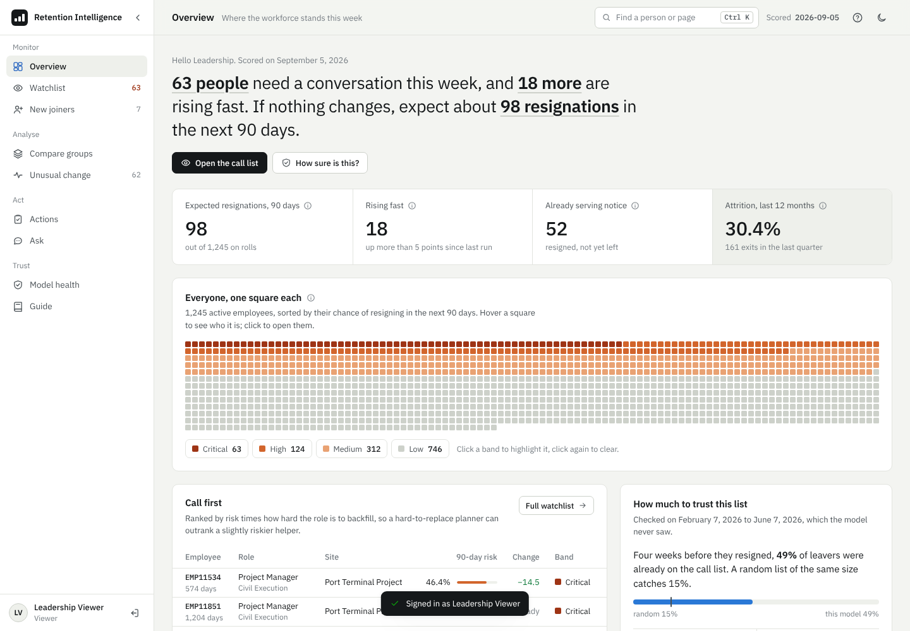
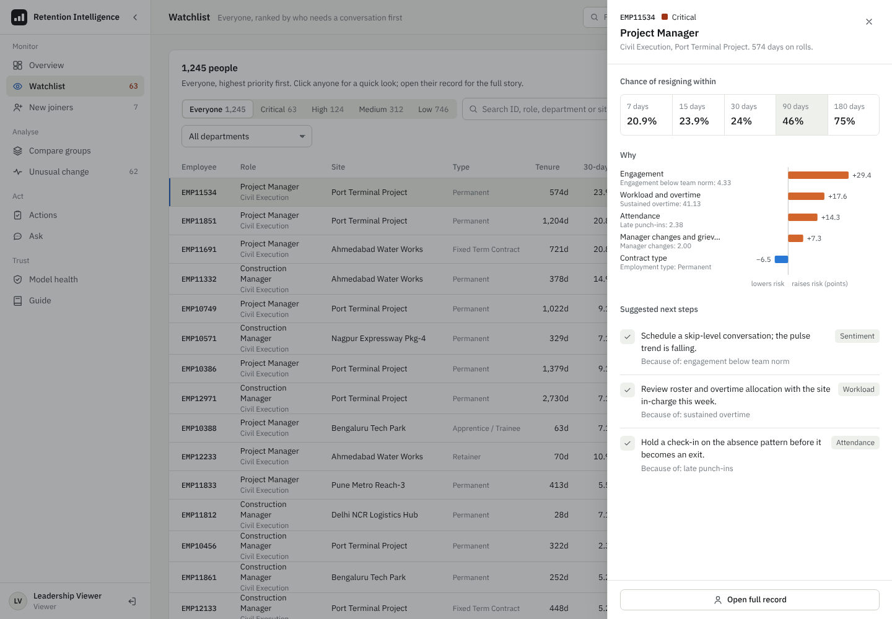
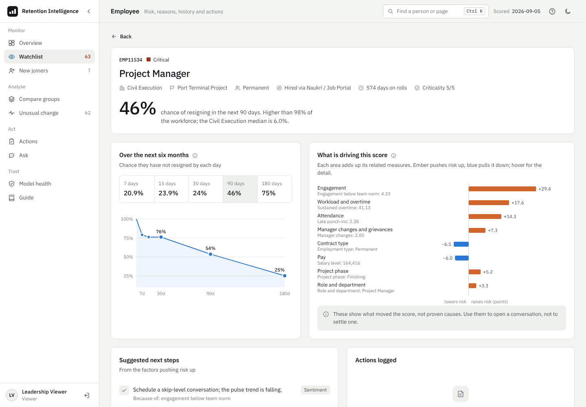
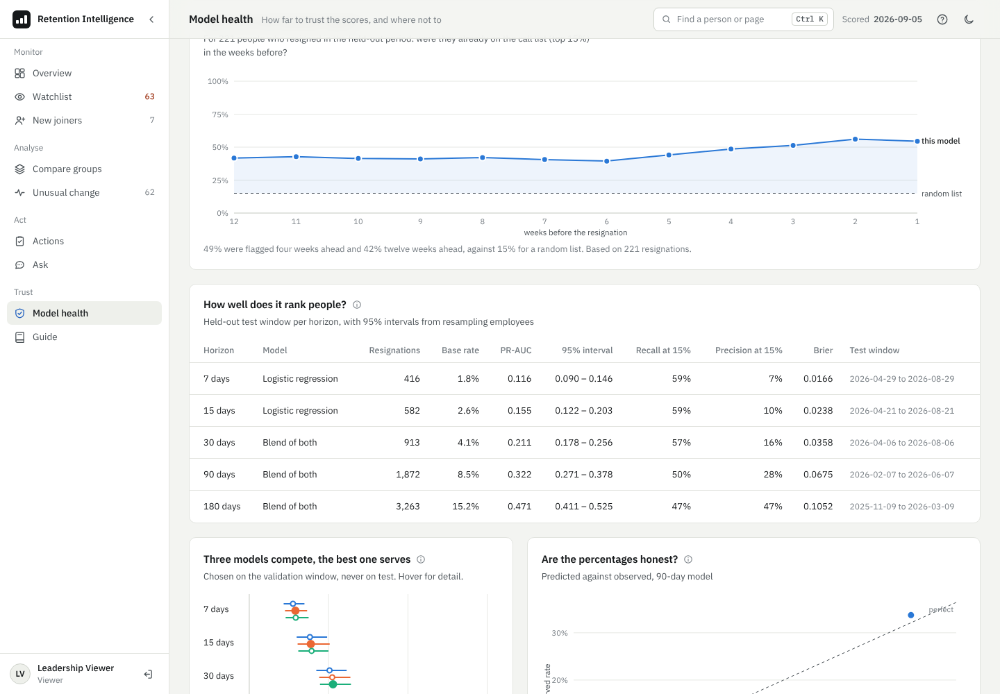
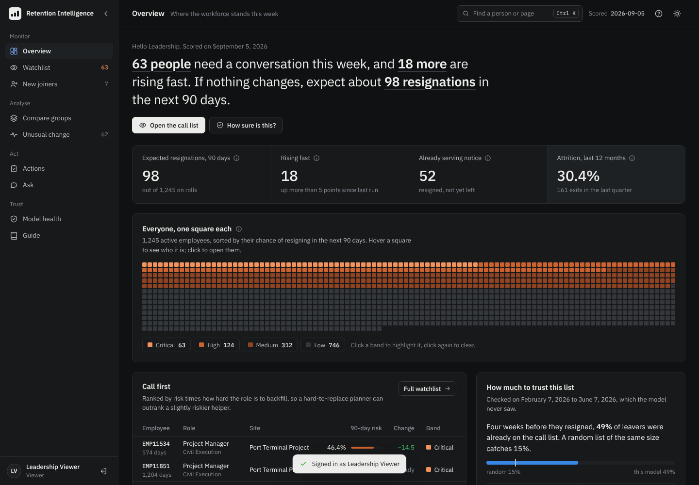

# Retention Intelligence

Resignation early warning for a construction and EPC workforce: who is likely to decide to resign in the next 7 to 180 days, why, and what to do about it.


**Live demo: [retention-intelligence-b3zd.onrender.com](https://retention-intelligence-b3zd.onrender.com)**. Choose the read-only **Viewer** account. It runs on Render's free plan, so the first visit after a quiet spell takes about 50 seconds to wake. All data is synthetic.



| Watchlist with quick look | Employee record |
|---|---|
|  |  |
| **Model health** | **Dark theme** |
|  |  |

## Results

Measured on held-out windows the model never saw, with an h-day gap between training, validation and test so that no label looks into the next window. Intervals resample employees, not rows.

| Horizon | Model | Base rate | PR-AUC [95% CI] | Resignations caught by the top 15% |
|---|---|---|---|---|
| 7 days | Logistic regression | 1.8% | 0.116 [0.090–0.146] | 59% |
| 30 days | Blend | 4.1% | 0.211 [0.178–0.256] | 57% |
| 90 days | Blend | 8.5% | 0.322 [0.271–0.378] | 50% |
| 180 days | Blend | 15.2% | 0.471 [0.411–0.525] | 47% |

- **Lead time.** Four weeks before resigning, 49% of leavers were already on the call list (top 15%); twelve weeks before, 42%. A random list catches 15%.
- **Right reasons.** The demo data comes from a simulator with known causes. SHAP recovers 11 of 16 planted causes in the right direction and gives two pure-noise inputs under 0.5% of attribution.
- **Known weak spot.** The model under-predicts sites hit by a sudden salary-delay shock (Ahmedabad Water Works at 0.59× of actual in the test period). Model health flags it, and the drift monitor shows why.

The full method, the v1 bugs and their measured impact, and the experiments that were rejected are in **[docs/MODEL_STUDY.md](docs/MODEL_STUDY.md)**.

## How it works

```
data/raw CSVs ─► SQLite warehouse ─► leakage-safe weekly features (106 numeric + 8 categorical)
   ─► labels per horizon: the resignation decision, terminations censored, full windows only
   ─► per horizon: embargoed split ─► gradient boosting / logistic / blend ─► best on validation
   ─► isotonic calibration ─► refit on recent data
   ─► weekly scoring: monotone horizon risks, bands, priority, SHAP by area, anomaly score
   ─► FastAPI ─► dashboard
```

| Piece | Where | What it does |
|---|---|---|
| Simulator | `src/attrition/data/generate.py` | Weekly panel for 3,200 employees from an explicit hazard with known causes |
| Features | `src/attrition/features/build.py` | Levels, rolling windows, trends and HR composites; labels with censoring |
| Models | `src/attrition/models/horizon.py` | Three candidates per horizon, calibration, exact log-odds SHAP for each |
| Training | `src/attrition/models/train.py` | Embargoed splits, champion selection, intervals, lead time, SHAP check, refit |
| Evaluation | `src/attrition/models/evaluate.py` | Cluster bootstrap, fairness at the call-list cut, C-index, lead time, drift |
| Survival | `src/attrition/models/survival.py` | Independent discrete-time hazard model, kept as a cross-check |
| Anomalies | `src/attrition/models/anomaly.py` | Isolation Forest on week-on-week change, separate from risk |
| Scoring | `src/attrition/scoring/score.py` | Weekly run, priority = risk percentile × role criticality |
| API | `src/attrition/api/` | FastAPI, sessions, roles (viewer, HR manager, admin), CSRF, audit log |
| Ask | `src/attrition/copilot/assistant.py` | Answers from live queries; an LLM only rephrases retrieved facts, if configured |
| Dashboard | `frontend/` | Static HTML, CSS and JS with hand-built SVG charts; no CDN, works behind a site proxy |

## Using the dashboard

- **Overview**: this week in one sentence, everyone as one square, who to call first, and how far to trust the list.
- **Watchlist**: sort any column, filter by band, site, department or text. Click a row (or press Enter) for a quick look; `j` and `k` move through people, `Esc` closes.
- **Employee**: risk at five horizons, a six-month retention curve built from the same numbers, the reasons grouped by area, weekly behaviour, history and logged actions.
- **Model health**: lead time, accuracy with intervals, the three candidate models, calibration, the SHAP check, fairness by group, drift.
- `Ctrl K` finds any person or page. Light and dark themes follow your system setting until you choose one.

## Run it

Python 3.10 or later.

```bash
pip install -r requirements.txt
PYTHONPATH=src python -m attrition.cli pipeline   # data, features, training, scoring (about 3 min)
PYTHONPATH=src python -m attrition.cli serve      # http://127.0.0.1:8000
```

Or `make pipeline && make serve`, or `scripts/setup.sh` then `scripts/run.sh` (`.bat` versions for Windows).

**Docker**

```bash
docker compose up --build
```

The image builds the data and trains the models during the build, so the container starts ready to serve.

**Render.** `render.yaml` deploys the Docker image on the free plan. Admin and HR-manager passwords are generated as private environment values, so the public demo exposes only the viewer account.

**Tests**

```bash
PYTHONPATH=src python -m pytest -q    # 54 tests; API tests need the pipeline to have run
```

The tests pin the properties that matter most: features never use the future, labels respect censoring, every split has its embargo, horizon risks never decrease with the horizon, the curve matches the headline numbers, protected routes refuse anonymous access, and viewers cannot log actions.

## Using real HR data

Export the four tables in `data/raw/data_dictionary.csv` from your HRMS (CSV, gzip or Excel) into `data/raw` and run the pipeline. It never overwrites files that are already there. If your outcomes have no `NoticeDate`, the pipeline falls back to `ExitDate` (last working day), which predicts later and less usefully.

## Responsible use

This is decision support for retention conversations. Do not use it to terminate, discipline, deny promotion, or set pay. Scores describe patterns in past data, not causes, and the fairness table shows where the model is less reliable. Real deployments need human review, access control, data minimisation, and legal review.

## Limitations

- Synthetic data: the results show the method works when the causes are known, not how it performs on a real workforce.
- Rare site-level shocks are under-learnt (see Results).
- The three candidate models are statistically tied on this data; on real data the winner will differ.

## Licence and author

MIT, see [LICENSE](LICENSE). IBM Plex fonts under the SIL Open Font License (`frontend/assets/fonts/OFL.txt`).

Omkar Gadhave: [LinkedIn](https://www.linkedin.com/in/omkar-gadhave-data/), omkarg3737@gmail.com
